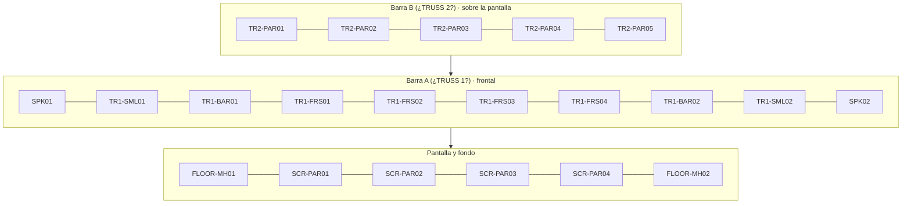

# Vista frontal

Desde la congregación mirando al escenario. Esquema `ESTIMADO`, sin escala. La altura relativa viene de las fotos. Izquierda a derecha según la congregación.

El orden de arriba hacia abajo indica altura relativa aproximada. No hay medidas.

Vista interactiva del esquema: https://claude.ai/artifact/TGTsVGhx3vJSkwVbcWaLhH (usa los códigos P, G, F, B, M, C; ver equivalencias en `inventory/fixtures.md`).
